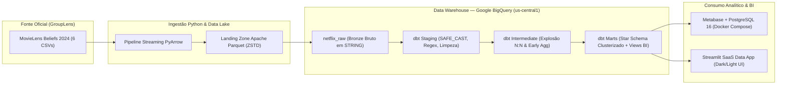

# Streaming & Recommendation Analytics Platform (Netflix / MovieLens Beliefs 2024)


[](https://github.com/LuciannErlan/engenharia-de-dados-netflix/actions/workflows/ci.yml)

Plataforma analítica **end-to-end (ELT)** construída para modelar comportamento de audiência em catálogos de streaming e avaliar a assertividade de algoritmos de recomendação utilizando o dataset oficial **MovieLens Beliefs 2024** (*GroupLens Research — University of Minnesota*).

> Projeto desenvolvido como evolução arquitetural para portfólio de **Engenharia de Dados & Analytics Engineering** a partir da base proposta por Luiza Vieira (*Dados Por Todos*), adicionando ingestão automatizada em **Apache Parquet**, transformações governadas com **dbt Core** (testes de schema, *unit tests* e linhagem), persistência transacional para o **Metabase via Docker Compose**, **Data App interativo em Streamlit** e **Integração Contínua (CI)**.

---

## 1. Arquitetura da Plataforma



---

## 2. Métricas Reais de Engenharia & Processamento

| Indicador Técnico | Resultado Medido em Execução Real |
| :--- | :--- |
| **Volume Bruto Ingerido (`netflix_raw`)** | **10.710.689 registros** distribuídos em 6 tabelas (`movies`, `user_rating_history`, `ratings_for_additional_users`, `belief_data`, `movie_elicitation_set`, `user_recommendation_history`) |
| **Compressão Colunar (`CSV → Apache Parquet ZSTD`)** | **482,46 MB → 101,80 MB (-78,9% de redução)** via streaming em lotes com `pyarrow` |
| **Deduplicação e Saneamento (`fact_ratings`)** | **6.231.812 → 5.403.088 avaliações únicas** (`828.724` sobreposições históricas removidas deterministicamente) |
| **Catálogo & Audiência (`dim_movies` / `dim_users`)** | **105.071 filmes** (`80.984` avaliados), **20 dimensões de gênero** (`182.644` pares N:N) e **16.876 usuários** (`1997-09-15` a `2024-05-05`) |
| **Qualidade & Governança Automatizada** | **22 modelos dbt** (`PASS=22`), **48 testes dbt** (`46` schema/integridade + `2` *unit tests*, `PASS=48`), **15 testes `pytest`** (`100% pass`) e `ruff` zero *warnings* |

---

## 3. Diferenciais de Engenharia Implementados

| Decisão Técnica | Motivação e Impacto Real |
| :--- | :--- |
| **Conversão Streaming CSV → Parquet (ZSTD)** | Uso de `pyarrow.csv.open_csv` em lotes (*batches*) de baixa memória convertendo os 6 CSVs para formato colunar ZSTD antes da carga no BigQuery, reduzindo **78,9%** do volume em disco/rede e acelerando *Load Jobs*. |
| **Camada Raw *Schema-on-Read* (`STRING`)** | Todas as colunas brutas chegam ao `netflix_raw` como `STRING` enriquecidas com metadados de auditoria (`_ingested_at`, `_source_file`), blindando a ingestão contra falhas de tipagem na origem. |
| **Arquitetura Medallion + Star Schema no `dbt Core`** | Separação clara entre `staging` (limpeza, Regex de ano, tratamento de sentinelas `-1` e deduplicação), `intermediate` (explosão N:N de gêneros e *early aggregation*) e `marts` (dimensões `dim_movies`, `dim_genres`, `bridge_movie_genres`, `dim_users`, `dim_date` e fatos `fact_ratings`, `fact_beliefs`). |
| **Compatibilidade Inteligente BigQuery Sandbox vs. Produção** | Em vez de perder dados históricos (1997–2024) devido à expiração automática de 60 dias por partição de data do BigQuery Sandbox, as tabelas fato e dimensão aplicam *Clustering* estratégico (`movie_id`, `user_id`) com `hours_to_expiration: 1400` no Sandbox e habilitam particionamento mensal automaticamente quando `is_bigquery_sandbox: false`. |
| **Score Ponderado Bayesiano (Estilo IMDb/Netflix)** | Evita que filmes com 1 ou 2 notas `5.0` distorçam o ranking de qualidade, ponderando a média individual do título pela média global (`3,444 ★`) e corte mínimo de confiança (`m = 50`). |
| **Lab de Recomendação (`belief_data`)** | Vai além dos rankings clássicos de catálogo ao cruzar a **expectativa prévia do usuário**, a **nota prevista pelo sistema** e a **nota real pós-consumo** por canal de descoberta (*Popularidade, Bem Avaliado, Lançamento Popular, Em Tendência e Serendipidade*). |
| **Metabase com Persistência Real** | Substitui o banco H2 volátil do `docker run` simples por um `docker-compose.yml` orquestrando `metabase/metabase` + `postgres:16-alpine` com volume persistente (`netflix_metabase_pgdata`). |

---

## 4. Modelo Dimensional (Kimball Star Schema)

- **`dim_movies`**: Catálogo de `105.071` filmes com `clean_title`, `release_year` extraído via expressão regular, década, lista de gêneros e `bayesian_weighted_score`.
- **`dim_genres` & `bridge_movie_genres`**: Resolução normalizada do relacionamento muitos-para-muitos (N:N) entre títulos e gêneros cinematográficos (`182.644` vínculos).
- **`dim_users`**: Perfil comportamental anônimo (`16.876` usuários) com volume de notas, média, desvio padrão (`σ`), janela de retenção em dias e segmentação (`Power Reviewer`, `Heavy Watcher`, `Engaged`, `Casual`).
- **`dim_date`**: Calendário analítico contínuo (`9.730` dias) cobrindo todo o intervalo histórico de interações.
- **`fact_ratings`**: Histórico consolidado e deduplicado de `5.403.088` avaliações reais (`0.5` a `5.0` estrelas), com integridade referencial garantida.
- **`fact_beliefs`**: `3.004.084` registros de elicitação de expectativa humana vs. nota prevista pelo motor de recomendação vs. nota real pós-consumo (`expectation_surprise_gap`, `system_abs_error`, `user_abs_error`).

---

## 5. Principais Insights Analíticos Extraídos

1. **Qualidade Ponderada vs. Popularidade Bruta**: Enquanto os títulos de maior alcance absoluto são *Inception (2010)* (`10.201` notas), *The Matrix (1999)* (`10.124`) e *The Shawshank Redemption (1994)* (`10.067`), o ranking Bayesiano destaca produções de aclamação consistente como *Band of Brothers (2001)* (`4,354`), *The Shawshank Redemption (1994)* (`4,346`) e *Planet Earth (2006)* (`4,333`).
2. **Dinâmica de Gêneros**: *Drama* (`2,33M` avaliações em `31.758` títulos) e *Comedy* (`1,75M`) lideram em volume absoluto, mas *Film-Noir* (`3,752 ★`, `σ = 0,888`) e *War* (`3,663 ★`) apresentam a maior aprovação crítica e menor polarização, enquanto *IMAX* registra a maior densidade de engajamento por obra (`1.566,4` avaliações/filme).
3. **Paradoxo da Serendipidade em Recomendação (`MAE Global = 0,653 ★`)**: No canal de **Serendipidade**, os usuários demonstram ceticismo prévio antes de assistir (expectativa média de apenas `2,157 ★`), porém, quando assistem ao título recomendado, atribuem nota real média de **`3,822 ★`** — superando inclusive a previsão do próprio algoritmo (`3,539 ★`) e comprovando o valor de recomendações fora da bolha óbvia de popularidade.

---

## 6. Visualizações Analíticas Construídas

Cobertura integral dos **7 visuais de negócio da aula base** + **2 visuais exclusivos de Machine Learning / Produto**:

1. **Heatmap Temporal (Ano × Mês)**: Sazonalidade e evolução histórica do volume de avaliações.
2. **Top Filmes por Qualidade**: Ranking ordenado pelo Score Bayesiano ponderado.
3. **Top Filmes Mais Avaliados**: Títulos líderes em alcance e engajamento histórico.
4. **Popularidade dos Gêneros**: Distribuição de avaliações por gênero (via *Bridge Table* sem inflar contagens).
5. **Tabela Comportamental de Usuários**: Segmentação por *tier* de atividade, rigor crítico (`σ`) e retenção.
6. **Scatter Plot — Filmes (Popularidade vs. Qualidade)**: Classificação automática em 4 quadrantes analíticos (*Muito Popular + Bem Avaliado*, *Joia Cult*, *Popular Abaixo da Média* e *Baixa Adesão*).
7. **Scatter Plot — Gêneros (Popularidade vs. Qualidade)**: Volume vs. nota média vs. tamanho de catálogo e divergência (`σ`).
8. **[Diferencial] Expectativa Humana vs. Algoritmo vs. Nota Real**: Avaliação de MAE e *Surprise Gap* por estratégia de recomendação.
9. **[Diferencial] Curva de Calibração de Certeza (1 a 5)**: Convergência entre confiança declarada pelo usuário e predição algorítmica.

---

## 7. Estrutura do Repositório

```text
engenharia_de_dados_com_Netflix/
├── .github/workflows/ci.yml        # Pipeline CI (Ruff + Pytest + dbt parse)
├── dashboard/app.py                # Data App Executivo em Streamlit + Plotly (Dark/Light Mode)
├── dbt_netflix/                    # Projeto dbt Core (Bronze -> Silver -> Gold Star Schema)
│   ├── macros/                     # Custom schema naming macro
│   └── models/
│       ├── staging/                # 5 views + _sources.yml + _staging_models.yml + unit tests
│       ├── intermediate/           # 2 views (explosão N:N de gêneros + early aggregation)
│       └── marts/
│           ├── core/               # 7 tabelas clusterizadas (Star Schema Kimball + unit tests)
│           └── analytics/          # 8 views prontas para BI (Metabase & Streamlit)
├── docker/docker-compose.yml       # Metabase + PostgreSQL 16 com volume persistente
├── docs/                           # Catálogo SQL do Metabase e Guia de Publicação de Portfólio
├── scripts/                        # Automação PowerShell para Service Account least-privilege
├── src/
│   ├── bi/bootstrap_metabase.py    # Provisionamento BI-as-Code (Conexão BQ, 9 Cards e Dashboard Público)
│   └── ingestion/                  # Download resiliente, conversão PyArrow ZSTD, carga BQ e cache Gold
└── tests/test_ingestion.py         # Suite de testes unitários Pytest
```

---

## 8. Como Executar o Projeto do Zero

### Pré-requisitos
- **Python 3.11+**
- **Google Cloud SDK (`gcloud` + `bq`)** autenticado em um projeto GCP (funciona 100% gratuitamente no **BigQuery Sandbox**, sem necessidade de cartão de crédito)
- **Docker Desktop** (para subir o Metabase + PostgreSQL local)

### Passo 1 — Configurar Ambiente Virtual e Variáveis
```powershell
python -m venv .venv
.\.venv\Scripts\python.exe -m pip install -r requirements.txt
Copy-Item .env.example .env
# Ajuste GCP_PROJECT_ID no arquivo .env caso utilize outro ID de projeto
```

### Passo 2 — Autenticar no Google Cloud
```powershell
gcloud auth login
gcloud auth application-default login
gcloud config set project SEU_PROJECT_ID
```

### Passo 3 — Executar Ingestão (GroupLens → Parquet ZSTD → BigQuery `netflix_raw`)
```powershell
.\.venv\Scripts\python.exe -m src.ingestion.run_pipeline
```

### Passo 4 — Construir e Testar o Data Warehouse com `dbt Core`
```powershell
Set-Location dbt_netflix
..\.venv\Scripts\dbt.exe compile --profiles-dir .
..\.venv\Scripts\dbt.exe run --profiles-dir .
..\.venv\Scripts\dbt.exe test --profiles-dir .
Set-Location ..
```

### Passo 5 — Exportar Cache Gold & Abrir o Data App Streamlit
```powershell
.\.venv\Scripts\python.exe -m src.ingestion.export_gold_cache
.\.venv\Scripts\streamlit.exe run dashboard/app.py
```

### Passo 6 — Subir o Metabase Corporativo & Provisionar Dashboard (BI-as-Code)
```powershell
# 1. Subir Metabase + PostgreSQL 16 persistente
docker compose -f docker/docker-compose.yml up -d

# 2. Gerar Service Account least-privilege para leitura segura do BigQuery
.\scripts\setup_gcp_service_account.ps1 -ProjectId netflix-analytics-de

# 3. Provisionar conexão BigQuery, 9 Cards e Dashboard Público automaticamente via API REST
.\.venv\Scripts\python.exe -m src.bi.bootstrap_metabase
```
Acesse `http://localhost:3000` (ou diretamente o link público gerado pelo comando acima) ou consulte manualmente o catálogo SQL em [`docs/metabase_questions.sql`](./docs/metabase_questions.sql).

---

## 9. Qualidade de Código, Catálogo de Linhagem e Testes Automatizados

```powershell
.\.venv\Scripts\ruff.exe check src tests dashboard
.\.venv\Scripts\pytest.exe -v
.\.venv\Scripts\dbt.exe docs generate --project-dir dbt_netflix --profiles-dir dbt_netflix
```

